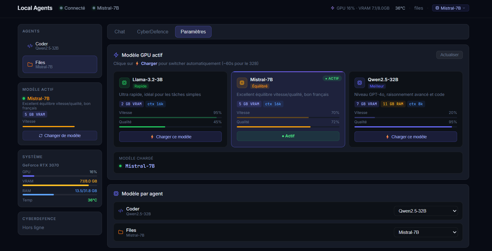

<div align="center">

# 🤖 Local Agents

**Agent IA 100% local — GPU natif, zéro cloud, zéro abonnement**


</div>

---

## 📸 Interface

### Chat — Monitoring GPU en temps réel


> Chat avec l'agent Files sur Mistral-7B — GPU 28%, VRAM 7.0/8.0GB, 39°C, temps de réponse 5.3s

### Paramètres — Switcher de modèle



> Switch entre Llama-3.2-3B, Mistral-7B (actif ●) et Qwen2.5-32B en 1 clic — barres vitesse/qualité, VRAM, RAM DDR5

---

## ✨ Fonctionnalités

| Fonctionnalité | Description |
|---|---|
| 🎯 **100% local** | Zéro cloud, zéro API payante, données privées |
| ⚡ **GPU natif** | llama.cpp avec CUDA — RTX 3070 optimisé |
| 🔄 **Switch modèle** | Change de modèle en 1 clic depuis l'interface |
| 📁 **Filesystem** | Lit, crée et modifie des fichiers réels |
| 💻 **VSCode bridge** | Ouvre les fichiers directement dans VSCode |
| 📊 **Monitoring** | GPU%, VRAM, RAM, température, tokens/sec en live |
| 🌐 **Interface web** | Dashboard dark mode, WebSocket temps réel |
| 🛡️ **CyberDefence** | Monitoring sécurité intégré |

---

## 🖥️ Hardware requis

| Composant | Minimum | Setup testé |
|---|---|---|
| GPU | GTX 1060 6GB | **RTX 3070 8GB** |
| RAM | 16 GB | **32 GB DDR5** |
| CPU | 4 cores | **i5-13600KF** |
| OS | Windows 10 | **Windows 11** |
| Stockage | 10 GB | SSD NVMe |

---

## 🤖 Modèles supportés

| Modèle | VRAM | RAM DDR5 | Vitesse | Qualité | Équivalent |
|---|---|---|---|---|---|
| **Llama-3.2-3B Q4_K_M** | 2 GB | 0 GB | ~50 t/s | ⭐⭐ | GPT-3 |
| **Mistral-7B Q4_K_M** | 5 GB | 0 GB | ~30 t/s | ⭐⭐⭐ | GPT-3.5 |
| **Qwen2.5-32B Q4_K_S** | 7 GB | 11 GB | ~4 t/s | ⭐⭐⭐⭐⭐ | GPT-4o |

Les modèles `.gguf` se placent dans :
```
C:\Users\<user>\AppData\Local\Ollama\models\
```

---

## 🚀 Installation

### 1. Prérequis

- [Go 1.22+](https://go.dev/dl/)
- [Node.js 18+](https://nodejs.org/) (pour le bridge VSCode)
- [llama.cpp binaires CUDA](https://github.com/ggerganov/llama.cpp/releases/latest)

### 2. Cloner le projet

```powershell
git clone https://github.com/loic31000/local-agents.git
cd local-agents
git checkout Romano-branche
```

### 3. Télécharger llama.cpp

Va sur [github.com/ggerganov/llama.cpp/releases](https://github.com/ggerganov/llama.cpp/releases/latest) et télécharge :
- `llama-bXXXX-bin-win-cuda-cu12.4-x64.zip`

Extrais tout dans `C:\Users\<user>\local-agents\`

### 4. Télécharger un modèle

```powershell
# Place le .gguf dans :
C:\Users\<user>\AppData\Local\Ollama\models\
```

### 5. Lancer

```powershell
.\run_agent.bat
```

> C'est tout ! Le script détecte llama-server, le lance si nécessaire, compile Go et ouvre l'interface sur **http://localhost:8080**

---

## 📁 Structure du projet

```
local-agents/
├── cmd/
│   └── orchestrator/
│       ├── main.go              # Serveur HTTP + WebSocket
│       ├── model_switcher.go    # Switch modèle depuis l'UI
│       └── system_stats.go      # Stats GPU/RAM/TPS
├── internal/
│   ├── agent/
│   │   ├── base.go              # Logique agent + tool calling
│   │   └── types.go             # Types partagés
│   ├── llm/
│   │   ├── client.go            # Interface LLMClient
│   │   ├── llamacpp.go          # Client llama-server
│   │   └── ollama.go            # Client Ollama
│   └── tools/
│       ├── filesystem.go        # Lire/écrire fichiers
│       ├── git.go               # Commandes git
│       ├── terminal.go          # Exécution commandes
│       └── vscode.go            # Contrôle VSCode
├── web/static/index.html        # Interface web complète
├── prompts/
│   ├── coder.md                 # Prompt agent codeur
│   └── files.md                 # Prompt agent fichiers
├── docs/screenshots/            # Captures d'écran
├── bridge.js                    # Bridge Node.js → VSCode (port 3333)
├── config.yaml                  # Configuration
├── run_agent.bat                # 🚀 Lance tout en 1 commande
├── start_llama.bat              # Lance llama-server seul
└── start_bridge.bat             # Lance le bridge VSCode
```

---

## ⚙️ Configuration

`config.yaml` — les options principales :

```yaml
llm_backend: "llamacpp"

llamacpp:
  server_url: "http://localhost:8081"
  default_model: "Qwen2.5-32B-Instruct-Q4_K_S"

agents:
  coder:
    enabled: true
    tools: [vscode, git, terminal, filesystem]
    allowed_paths:
      - "C:\\Users\\romano\\local-agents"
      - "C:\\Users\\romano\\Documents"

  files:
    enabled: true
    tools: [filesystem]
    allowed_paths:
      - "C:\\Users\\romano\\local-agents"
```

---

## 🌐 API

| Endpoint | Méthode | Description |
|---|---|---|
| `/api/health` | GET | Statut du serveur |
| `/api/agents` | GET | Liste des agents |
| `/api/chat/{agent}` | POST | Envoyer un message |
| `/api/model/list` | GET | Modèles disponibles |
| `/api/model/switch` | POST | Changer de modèle |
| `/api/system/stats` | GET | Stats GPU/RAM/TPS |
| `/api/llm/tps` | GET | Tokens/sec en temps réel |
| `/ws` | WebSocket | Temps réel |

---

## 💬 Utilisation des agents

### Format tool calling

````
```tool
{"tool": "filesystem", "params": {"action": "read", "path": "C:\\Users\\romano\\local-agents\\config.yaml"}}
```
````

### Actions disponibles

```
filesystem → read, write, list, delete
git        → status, add, commit, push, log
terminal   → command (PowerShell)
vscode     → open, read, write, replace, diff
```

### Exemples de prompts

```
"Lis le fichier main.go et explique l'architecture"
"Crée un fichier C:\local-agents\test.py avec un hello world"
"Liste tous les fichiers .go du projet"
"Ouvre config.yaml dans VSCode"
```

---

## 📊 Monitoring en temps réel

Le widget SYSTÈME affiche toutes les 5 secondes :

```
GeForce RTX 3070
GPU    ██░░░░░░  16%
VRAM   ███████░  7.1 / 8.0 GB
RAM    ████░░░░  13.5 / 31.8 GB
Temp   36°C  🟢
```

Chaque réponse affiche :
```
⏱ 5.3s    ⚡ 4.27 t/s
```

---

## 🔧 Services

| Service | Port | Commande |
|---|---|---|
| Interface web | 8080 | `run_agent.bat` (auto) |
| llama-server | 8081 | `start_llama.bat` ou auto |
| VSCode bridge | 3333 | `start_bridge.bat` |

---

## 🔄 Switch de modèle

Depuis **Paramètres → Modèle GPU actif** :

1. Clique **⚡ Charger ce modèle**
2. Attends ~10s (3B) ou ~60s (32B)
3. Badge **● Actif** vert confirmé

Le serveur redémarre automatiquement sans quitter l'interface.

---

## 📝 Changelog

### v0.2.0
- ✅ Backend llama.cpp GPU natif (sans Ollama)
- ✅ Switch de modèle depuis l'interface web
- ✅ Monitoring GPU/RAM/TPS en temps réel
- ✅ Bridge VSCode (Node.js standalone)
- ✅ Tokens/sec + durée sur chaque réponse
- ✅ Auto-switch modèle selon l'agent sélectionné
- ✅ `--metrics` llama-server activé

### v0.1.0
- ✅ Architecture multi-agents (Go)
- ✅ Interface web WebSocket
- ✅ Outils : filesystem, git, terminal, vscode

---

<div align="center">

**Fait avec ❤️ — 100% local, 100% privé**

*RTX 3070 · i5-13600KF · 32GB DDR5 · Windows 11*

</div>