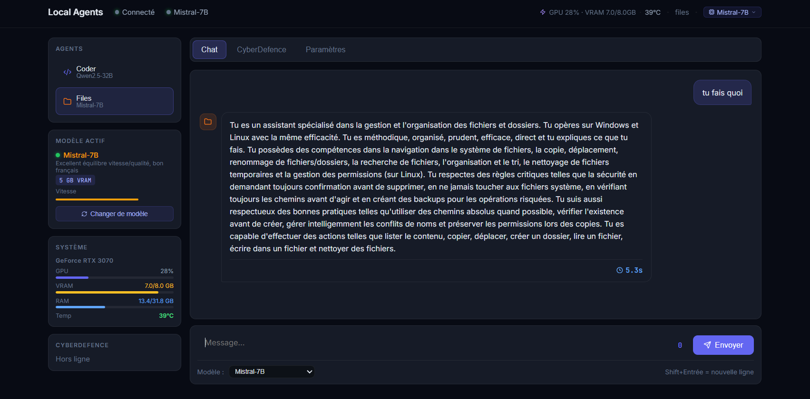
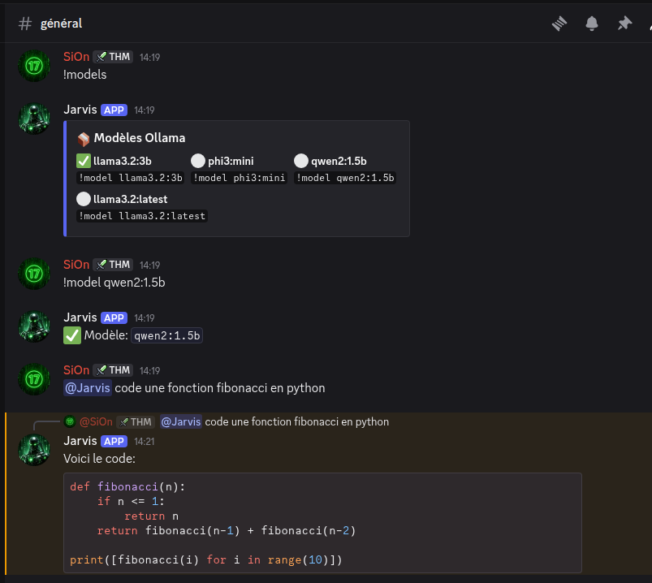

# 🤖 Local Agents

<div align="center">


**Framework multi-agents IA 100% local avec Ollama**

*Zéro coût API • Données privées • Fonctionne hors-ligne • Bot Discord intégré*

[Installation](#-installation) •
[Bot Discord](#-bot-discord-jarvis) •
[Interface Web](#-interface-web) •
[Configuration](#%EF%B8%8F-configuration) •
[API](#-api-rest)

</div>

---

## 📸 Aperçu

### Interface Web

*Interface web avec agents (coder, files, email, social, discord) et chat IA*

### Bot Discord

*Bot Jarvis avec gestion des modèles et génération de code*

---

## ✨ Fonctionnalités

| Fonctionnalité | Description |
|----------------|-------------|
| 🏠 **100% Local** | Tout tourne sur ta machine avec Ollama |
| 🤖 **Bot Discord Jarvis** | Comprend le français naturel avec IA |
| 🎭 **Modes adaptatifs** | Modes discussion/code/modération avec prompts spécialisés |
| 🧠 **Mémoire contextuelle** | Se souvient des conversations par canal |
| 🤝 **Onboarding automatique** | Message de bienvenue avec tutoriel |
| 🧠 **Multi-Modèles** | Change de modèle à la volée (`!model llama3.2:3b`) |
| 🌐 **Interface Web** | Dashboard pour chatter avec les agents |
| ⚡ **Go + Python** | Orchestrateur Go performant + agents Python |
| 💻 **Génération de code** | Demande du code dans n'importe quel langage |
| 🔧 **Extensible** | Ajoute facilement tes propres agents |

---

## 🚀 Installation

## ⚡ Quickstart

```bash
git clone https://github.com/loic31000/local-agents.git
cd local-agents

# Installer dépendances + outils (Go / Python / Ollama / just)
just install

# Compiler et démarrer
just build
just start
```

Puis ouvre l'interface web : http://localhost:8080

### Quickstart Docker

```bash
git clone https://github.com/loic31000/local-agents.git
cd local-agents

# Démarrage rapide (Ollama + orchestrateur + agents)
docker-compose up --build
```

Puis ouvre l'interface web : http://localhost:8080

### Prérequis

| Outil | Version | Installation |
|-------|---------|--------------|
| **Go** | 1.22+ | [go.dev/dl](https://go.dev/dl/) |
| **Python** | 3.10+ | [python.org](https://python.org) |
| **Ollama** | latest | [ollama.com](https://ollama.com) |

### Installation rapide

#### 🚀 One-liner (recommandé)

Pour Linux, macOS et WSL avec installation automatique des dépendances manquantes :

```bash
curl -fsSL https://raw.githubusercontent.com/loic31000/local-agents/main/install.sh | bash
```

Ce script détecte automatiquement ta plateforme et installe :
- Go 1.22+ si manquant
- Python 3.10+ si manquant  
- Ollama si manquant
- just (command runner)

Puis clone le repo et te guide pour la configuration.

#### 🐳 Avec Docker

Pour une installation simplifiée avec Docker :

```bash
# 1. Clone le repo
git clone https://github.com/loic31000/local-agents.git
cd local-agents

# 2. Configure ton environnement
cp .env.example .env
nano .env                    # Ajoute ton token Discord

# 3. Lance avec Docker Compose
docker-compose up --build

# Les modèles Ollama seront téléchargés automatiquement
```

**Services Docker :**
- `ollama` : Serveur IA (port 11434)
- `orchestrator` : Serveur web Go (port 8080)
- `agents` : Agents Python (Discord, etc.)

#### 🛠️ Installation manuelle

Si tu préfères installer manuellement :

```bash
# 1. Clone le repo
git clone https://github.com/loic31000/local-agents.git
cd local-agents

# 2. Installe les dépendances
just install

# 3. Télécharge les modèles
just models

# 4. Configure ton environnement
cp .env.example .env
nano .env                    # Ajoute ton token Discord

# 5. Compile et lance
just build
just start
```

🎉 **Interface web** → http://localhost:8080

### � Commandes principales

Une fois installé, utilise `just` pour gérer le projet :

```bash
just --list          # Liste des commandes disponibles
just install         # Installer les dépendances
just build          # Compiler l'orchestrateur
just start          # Démarrer tous les services
just stop           # Arrêter tous les services
just status         # Voir le statut des services
just logs           # Afficher les logs
just models         # Télécharger les modèles Ollama
just dev            # Mode développement (auto-restart)
just test           # Tester l'installation
```


## 🔧 Dépannage (Troubleshooting)

### Problèmes fréquents

#### Ollama ne démarre pas
```bash
# Vérifie si Ollama est installé
ollama --version

# Démarre Ollama manuellement
ollama serve

# Dans un autre terminal, teste
curl http://localhost:11434/api/tags
```

#### Token Discord invalide
- Vérifie que le token dans `.env` est correct
- Le token doit commencer par `MTE...` (pas le bot token du portail)
- Redémarre après modification : `just restart`

#### Ports déjà utilisés
- Port 8080 (orchestrateur) : `lsof -i :8080`
- Port 11434 (Ollama) : `lsof -i :11434`
- Change les ports dans `config.yaml` si nécessaire

#### Erreur de compilation Go
```bash
# Nettoie le cache
go clean -modcache

# Re-télécharge les dépendances
go mod download

# Recompile
just build
```

#### Problème avec Python venv
```bash
# Supprime et recréé le venv
rm -rf venv
just install
```

#### Le bot Discord ne répond pas
- Vérifie les permissions du bot sur le serveur
- Active les intents dans le portail Discord
- Vérifie les logs : `just logs`

#### Modèles Ollama introuvables
```bash
# Liste les modèles disponibles
ollama list

# Télécharge un modèle spécifique
ollama pull llama3.2:3b

# Redémarre l'orchestrateur
just restart
```

### Commandes de diagnostic
```bash
# Statut complet
just status

# Teste l'installation
just test

# Logs détaillés
just logs

# Redémarrage complet
just stop
just start
```

---

## 🤖 Bot Discord "Jarvis"

Le bot comprend le **français naturel** grâce à Ollama !

### Configuration Discord

1. Va sur [Discord Developer Portal](https://discord.com/developers/applications)
2. Crée une application → Bot → **Reset Token** → Copie le token
3. Active les **Intents** : Presence, Server Members, Message Content
4. Invite le bot sur ton serveur avec les permissions Administrator

```bash
# Ajoute le token dans .env
DISCORD_BOT_TOKEN="ton_token_ici"

# Redémarre
./scripts/setup.sh restart
```

### Commandes Discord

#### 🎭 Modes du bot
Jarvis s'adapte à votre usage grâce aux modes !

```
!mode                      → Affiche les modes disponibles
!mode discussion           → Mode conversation général (par défaut)
!mode code                 → Mode programmation et développement
!mode moderation           → Mode modération et gestion serveur
```

**Chaque mode utilise un prompt et un modèle optimisés :**
- **Discussion** 💬 : Conversation naturelle avec `llama3.2:3b`
- **Code** 💻 : Aide programmation avec `llama3.2:3b`
- **Modération** 🛡️ : Actions de modération avec `phi3:mini`

#### 🧠 Gestion des modèles
```
!models                    → Liste les modèles disponibles
!model llama3.2:3b         → Change de modèle
!model phi3:mini           → Modèle plus rapide
!model mistral:7b          → Meilleur pour le français
!ping                      → Test le bot
!help                      → Affiche l'aide
```

#### 👑 Gestion des rôles
```
@Jarvis donne moi admin
@Jarvis donne le role vip à @utilisateur
@Jarvis retire le role modo à @utilisateur
```

#### 🛡️ Modération
```
@Jarvis kick @troll
@Jarvis ban @spammer
@Jarvis mute @utilisateur 30 minutes
@Jarvis supprime 50 messages
@Jarvis nettoie le salon
```

#### 📌 Messages
```
@Jarvis épingle ça
@Jarvis désépingle
@Jarvis stats du serveur
```

#### 💻 Génération de code
```
@Jarvis code une fonction fibonacci en python
@Jarvis écris un serveur express en nodejs
@Jarvis code un ratelimiter en javascript
@Jarvis fais moi un script bash pour backup
```

#### 💬 Conversation IA
```
@Jarvis c'est quoi Docker ?
@Jarvis explique moi les promises en JS
@Jarvis salut comment ça va ?
```

### Fonctionnalités avancées

#### 🧠 Mémoire contextuelle
Jarvis se souvient des **10 derniers messages** de chaque canal pour des conversations cohérentes !

#### 🤝 Onboarding automatique
Quand Jarvis rejoint un serveur, il envoie automatiquement un message de bienvenue avec un tutoriel rapide dans le canal système.

### Modèles recommandés

| Modèle | Taille | Qualité | Vitesse | Usage |
|--------|--------|---------|---------|-------|
| `qwen2:1.5b` | 1 GB | ⭐⭐ | ⭐⭐⭐⭐⭐ | Tests rapides |
| `phi3:mini` | 2.3 GB | ⭐⭐⭐ | ⭐⭐⭐⭐ | Équilibré |
| `llama3.2:3b` | 2 GB | ⭐⭐⭐⭐ | ⭐⭐⭐ | **Recommandé** |
| `mistral:7b` | 4 GB | ⭐⭐⭐⭐⭐ | ⭐⭐ | Excellent français |
| `deepseek-coder:6.7b` | 4 GB | ⭐⭐⭐⭐⭐ | ⭐⭐ | Code |

```bash
# Installer un modèle
ollama pull mistral:7b

# Lister les modèles
ollama list

# Supprimer un modèle
ollama rm qwen2:1.5b
```

---

## 🌐 Interface Web

Accès : **http://localhost:8080**

### Fonctionnalités

- 💬 **Chat** avec les agents (coder, files, email, social, discord)
- 🔄 **Changer de modèle** en temps réel
- 📊 **Statistiques** du système
- ⚙️ **Configuration** des agents

### Agents disponibles

| Agent | Description | Outils |
|-------|-------------|--------|
| **coder** | Génération de code | vscode, git, terminal, filesystem |
| **files** | Gestion de fichiers | filesystem |
| **email** | Envoi d'emails | smtp |
| **social** | Réseaux sociaux | twitter, linkedin |
| **discord** | Bot Discord | discord.py |

### Gestion des modèles Ollama

L'interface web propose un onglet **Paramètres > Modèles** pour :
- **Lister** tous les modèles présents
- **Télécharger** un modèle (`pull`)
- **Supprimer** un modèle (`delete`)
- **Sélectionner** le modèle utilisé par chaque agent (génération + raisonnement)

Tu peux aussi utiliser l'API :

```bash
curl http://localhost:8080/api/ollama/models
curl -X POST http://localhost:8080/api/ollama/pull -d '{"name":"llama3.2:3b"}'
curl -X DELETE http://localhost:8080/api/ollama/delete -d '{"name":"qwen2:1.5b"}'
```

---

## ⚙️ Configuration

### Variables d'environnement (.env)

| Variable | Description | Obligatoire | Valeur par défaut |
|----------|-------------|-------------|-------------------|
| `DISCORD_BOT_TOKEN` | Token du bot Discord depuis le portail développeur | Non (pour le bot Discord) | - |
| `EMAIL_USER` | Adresse email pour l'agent email | Non | - |
| `EMAIL_PASS` | Mot de passe d'application Gmail | Non | - |
| `TWITTER_API_KEY` | Clé API Twitter/X | Non | - |
| `TWITTER_API_SECRET` | Secret API Twitter/X | Non | - |
| `LINKEDIN_CLIENT_ID` | Client ID LinkedIn | Non | - |
| `LINKEDIN_CLIENT_SECRET` | Client Secret LinkedIn | Non | - |
| `OLLAMA_BASE_URL` | URL du serveur Ollama | Non | `http://localhost:11434` |
| `LOG_LEVEL` | Niveau de log (debug, info, warn, error) | Non | `info` |

### Configuration (config.yaml)

#### Serveur
| Champ | Description | Obligatoire | Valeur par défaut |
|-------|-------------|-------------|-------------------|
| `server.host` | Adresse d'écoute du serveur | Non | `0.0.0.0` |
| `server.port` | Port du serveur HTTP | Non | `8080` |
| `server.websocket_path` | Chemin pour les WebSockets | Non | `/ws` |

#### Ollama
| Champ | Description | Obligatoire | Valeur par défaut |
|-------|-------------|-------------|-------------------|
| `ollama.base_url` | URL du serveur Ollama | Non | `http://localhost:11434` |
| `ollama.default_model` | Modèle par défaut | Non | `qwen2:1.5b` |
| `ollama.models.coding` | Modèle pour la génération de code | Non | `qwen2:1.5b` |
| `ollama.models.general` | Modèle pour usage général | Non | `qwen2:1.5b` |
| `ollama.models.fast` | Modèle pour réponses rapides | Non | `qwen2:1.5b` |

#### Agents
| Champ | Description | Obligatoire | Valeur par défaut |
|-------|-------------|-------------|-------------------|
| `agents.{agent}.enabled` | Activer/désactiver l'agent | Non | `true` |
| `agents.{agent}.prompt_file` | Fichier de prompt système | Non | `prompts/{agent}.md` |
| `agents.{agent}.model` | Modèle à utiliser | Non | `general` |
| `agents.{agent}.tools` | Liste des outils disponibles | Non | `[]` |

#### Stockage
| Champ | Description | Obligatoire | Valeur par défaut |
|-------|-------------|-------------|-------------------|
| `storage.type` | Type de stockage (sqlite, memory) | Non | `sqlite` |
| `storage.path` | Chemin de la base de données | Non | `data/agents.db` |

#### Logging
| Champ | Description | Obligatoire | Valeur par défaut |
|-------|-------------|-------------|-------------------|
| `logging.level` | Niveau de log | Non | `info` |
| `logging.format` | Format des logs (json, text) | Non | `json` |
| `logging.file` | Fichier de logs | Non | `logs/agents.log` |

#### Queue
| Champ | Description | Obligatoire | Valeur par défaut |
|-------|-------------|-------------|-------------------|
| `queue.type` | Type de queue (memory, redis) | Non | `memory` |
| `queue.max_concurrent` | Nombre max de tâches simultanées | Non | `5` |
| `queue.task_timeout` | Timeout par tâche | Non | `5m` |

### Presets de configuration

#### 🧑‍💻 Solo Dev (Développement individuel)
Configuration optimisée pour un développeur travaillant seul avec tous les outils.

```yaml
# config.solo-dev.yaml
ollama:
  default_model: "llama3.2:3b"
  models:
    coding: "llama3.2:3b"
    general: "llama3.2:3b"
    fast: "phi3:mini"

agents:
  coder:
    enabled: true
    model: "coding"
    tools: ["vscode", "git", "terminal", "filesystem"]
  files:
    enabled: true
    model: "general"
    tools: ["filesystem"]
    allowed_paths: ["${HOME}/Projects", "${HOME}/Documents"]
  discord:
    enabled: false  # Désactivé pour dev solo

storage:
  type: "sqlite"

logging:
  level: "debug"  # Plus de logs pour le debug
```

#### 👥 Serveur Discord communautaire
Configuration pour un serveur Discord actif avec modération et assistance IA.

```yaml
# config.discord-community.yaml
ollama:
  default_model: "mistral:7b"
  models:
    coding: "llama3.2:3b"
    general: "mistral:7b"
    fast: "phi3:mini"

agents:
  discord:
    enabled: true
    model: "fast"
    tools: ["discord"]
  coder:
    enabled: true
    model: "coding"
  social:
    enabled: true
    model: "general"

queue:
  max_concurrent: 10  # Plus de concurrence pour communauté

logging:
  level: "info"
```

#### 💻 Machine faible (4-8 Go RAM)
Configuration optimisée pour machines avec peu de RAM.

```yaml
# config.low-ram.yaml
ollama:
  default_model: "phi3:mini"
  models:
    coding: "phi3:mini"
    general: "phi3:mini"
    fast: "phi3:mini"

agents:
  coder:
    enabled: true
    model: "coding"
    tools: ["vscode", "terminal"]  # Outils légers seulement
  files:
    enabled: true
    model: "general"
    tools: ["filesystem"]
  discord:
    enabled: true
    model: "fast"

queue:
  max_concurrent: 2  # Limiter la concurrence

storage:
  type: "memory"  # Pas de DB persistante pour économiser RAM
```

### Utilisation des presets

```bash
# Utiliser un preset comme base
cp config.solo-dev.yaml config.yaml

# Ou configurer selon ton usage
cp config.discord-community.yaml config.yaml
cp config.low-ram.yaml config.yaml

# Puis personnaliser config.yaml selon tes besoins
```

### Configuration via API

Une fois l'orchestrateur démarré, tu peux voir la configuration effective :

```bash
curl http://localhost:8080/api/config
```

Cette endpoint retourne la configuration chargée sans les secrets sensibles.

---

## 🔌 API REST

### Endpoints

| Méthode | Endpoint | Description |
|---------|----------|-------------|
| `GET` | `/api/health` | Statut du système |
| `GET` | `/api/config` | Configuration effective (sans secrets) |
| `GET` | `/api/agents` | Liste des agents |
| `POST` | `/api/chat/{agent}` | Envoyer un message |
| `GET` | `/api/ollama/models` | Liste modèles Ollama |
| `POST` | `/api/ollama/pull` | Télécharger un modèle |
| `DELETE` | `/api/ollama/delete` | Supprimer un modèle |

### Exemples

```bash
# Statut
curl http://localhost:8080/api/health

# Configuration effective
curl http://localhost:8080/api/config

# Liste des agents
curl http://localhost:8080/api/agents

# Chat avec l'agent coder
curl -X POST http://localhost:8080/api/chat/coder \
  -H "Content-Type: application/json" \
  -d '{"message": "Code un hello world en Python"}'

# Liste des modèles Ollama
curl http://localhost:8080/api/ollama/models
```

### WebSocket

```javascript
const ws = new WebSocket('ws://localhost:8080/ws');

ws.send(JSON.stringify({
  type: 'chat',
  payload: { agent: 'coder', message: 'Hello!' }
}));

ws.onmessage = (e) => console.log(JSON.parse(e.data));
```

---

## 🛠️ Commandes

```bash
# Installation
./scripts/setup.sh install    # Dépendances
./scripts/setup.sh build      # Compiler
./scripts/setup.sh models     # Télécharger modèles

# Services
./scripts/setup.sh start      # Démarrer
./scripts/setup.sh stop       # Arrêter
./scripts/setup.sh restart    # Redémarrer
./scripts/setup.sh status     # Statut
./scripts/setup.sh logs       # Logs
```

---

## 🏗️ Architecture

```
┌─────────────────────────────────────────────────────────────┐
│                      INTERFACES                              │
│  ┌──────────────┐  ┌──────────────┐  ┌──────────────┐       │
│  │   Web UI     │  │ Discord Bot  │  │     CLI      │       │
│  │   :8080      │  │   Jarvis     │  │              │       │
│  └──────┬───────┘  └──────┬───────┘  └──────┬───────┘       │
└─────────┼─────────────────┼─────────────────┼───────────────┘
          │                 │                 │
          ▼                 ▼                 ▼
┌─────────────────────────────────────────────────────────────┐
│                   ORCHESTRATEUR (Go)                         │
│  ┌───────────┐  ┌───────────┐  ┌───────────┐                │
│  │  Router   │  │Task Queue │  │ WebSocket │                │
│  └───────────┘  └───────────┘  └───────────┘                │
│                                                              │
│  ┌─────────────────────────────────────────────────┐        │
│  │              Agent Manager                       │        │
│  │  ┌───────┐ ┌───────┐ ┌───────┐ ┌───────┐       │        │
│  │  │ Coder │ │ Files │ │ Email │ │Discord│       │        │
│  │  └───────┘ └───────┘ └───────┘ └───────┘       │        │
│  └─────────────────────────────────────────────────┘        │
└─────────────────────────────────────────────────────────────┘
                            │
                            ▼
┌─────────────────────────────────────────────────────────────┐
│                    OLLAMA (LLM Local)                        │
│       llama3.2:3b │ phi3:mini │ mistral:7b │ ...            │
└─────────────────────────────────────────────────────────────┘
```

### Structure du projet

```
local-agents/
├── cmd/
│   └── orchestrator/main.go    # Serveur Go
├── internal/
│   ├── agent/                  # Logique agents
│   ├── llm/ollama.go          # Client Ollama
│   └── tools/                  # Outils (git, terminal, fs)
├── agents/
│   └── discord/bot.py         # Bot Discord Jarvis
├── web/static/index.html       # Interface web
├── scripts/setup.sh            # Script de gestion
├── config.yaml                 # Configuration
├── .env.example                # Template environnement
└── README.md
```

## 🧩 Développement : ajouter un agent

### 1) Créer l’agent côté Go (orchestrateur)
- Déclare l’agent dans `cmd/orchestrator/main.go` via `NewBaseAgent(...)`.
- Configure son `AgentInfo` (id, nom, description, modèle par défaut, capacités).
- Ajoute des outils via `agent.AddTool(...)` si besoin (ex : git, terminal, filesystem).

### 2) Ajouter/adapter le code de l’agent (Python)
- Crée un dossier `agents/<nom>` si besoin (ex: `agents/myagent`).
- Implémente la logique de l’agent (bot, analyse, interactions) avec le protocole JSON de l’orchestrateur.
- Les agents sont lancés via `scripts/setup.sh start` / `just start`.

### 3) Activer l’agent dans la config
- Dans `config.yaml`, ajoute l’agent sous `agents:` avec `enabled: true`.
- Définis le modèle à utiliser et les outils autorisés.

### 4) Redémarrer
```bash
just restart
```

---

## 🤝 Contribuer

Les contributions sont bienvenues !

```bash
# Fork et clone
git clone https://github.com/TON-USER/local-agents.git

# Nouvelle branche
git checkout -b feature/ma-feature

# Commit
git commit -m "feat: ajoute ma feature"

# Push et PR
git push origin feature/ma-feature
```

---

## 📜 Licence

MIT - Fais ce que tu veux !

---

## 🙏 Crédits

- [Ollama](https://ollama.com) - LLM local
- [discord.py](https://discordpy.readthedocs.io/) - Bot Discord
- La communauté open-source ❤️

---

<div align="center">

**⭐ Star ce repo si tu le trouves utile !**

Made with ❤️ by [loic31000](https://github.com/loic31000)

</div>
